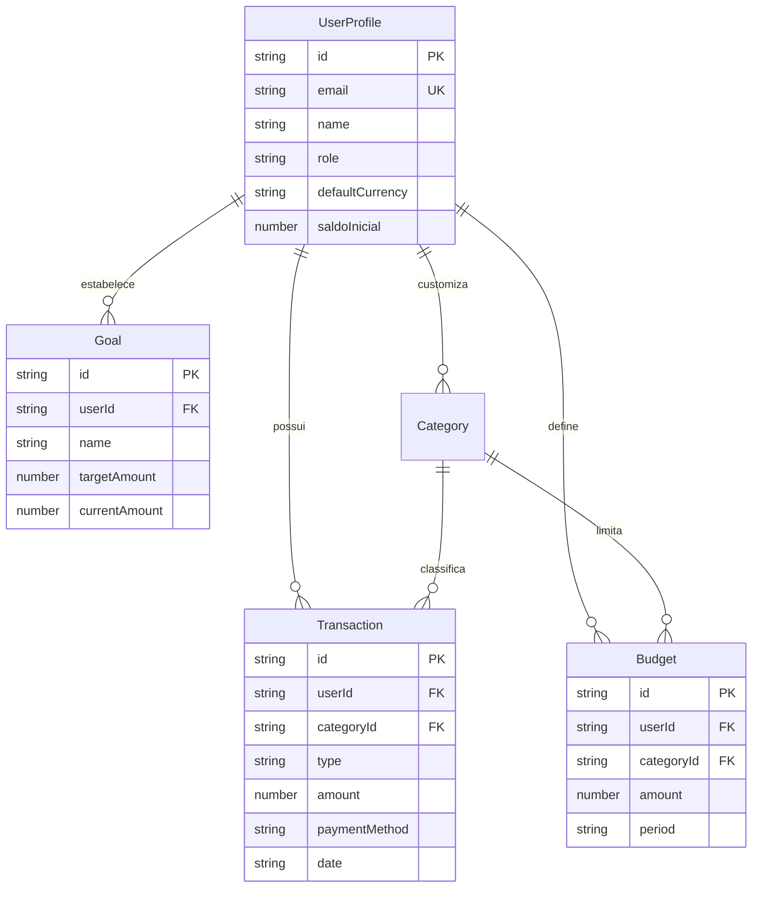

# Modelo de Dados & Contratos de Tipos - UniFinance

Este documento formaliza as entidades, atributos, relacionamentos e tipos TypeScript implementados em [`src/types/finance.ts`](file:///c:/Users/victo/OneDrive/Documentos/Github/UniFinance/src/types/finance.ts).

---

### 1. Entidades Principais

#### 1.1 `Transaction` (Movimentações)
Representa qualquer entrada (receita) ou saída (despesa) financeira.

| Campo | Tipo | Descrição |
| :--- | :--- | :--- |
| `id` | `string` | Identificador único com prefixo `tx_` |
| `userId` | `string` | ID do proprietário do registro |
| `type` | `'income' \| 'expense'` | Tipo da movimentação |
| `description` | `string` | Título / finalidade do lançamento |
| `amount` | `number` | Valor numérico positivo em Meticais |
| `categoryId` | `string` | ID da categoria vinculada |
| `paymentMethod` | `string` | Método utilizado (`M-Pesa`, `e-Mola`, `mKesh`, `Cartão`, `Dinheiro`, `Transferência`) |
| `date` | `string` | Data no formato ISO `YYYY-MM-DD` |
| `notes` | `string?` | Observações opcionais |
| `createdAt` | `string` | Timestamp ISO de criação |
| `updatedAt` | `string` | Timestamp ISO da última alteração |

#### 1.2 `Category` (Categorias)
Classificação das transações.
- `id`: Identificador (`inc-*` para receitas, `exp-*` para despesas ou `cat_*` para personalizadas).
- `userId?`: Se omitido, é uma categoria padrão do sistema ([`DEFAULT_CATEGORIES`](file:///c:/Users/victo/OneDrive/Documentos/Github/UniFinance/src/services/db.ts#L9)).
- `name`: Nome legível (ex: "Alimentação", "Educação", "Salário").
- `type`: `'income' | 'expense'`.
- `icon`: Nome do ícone da biblioteca Lucide React.
- `description?`: Explicação de escopo.

#### 1.3 `Budget` (Orçamentos Mensais)
Teto de consumo financeiro por categoria para o ciclo mensal.
- `id`: Prefixo `bud_`.
- `userId`: ID do utilizador.
- `categoryId`: Categoria monitorizada.
- `amount`: Teto monetário máximo.
- `period`: Fixado em `'monthly'`.
- `startDate`: Data ISO de início de vigência.

#### 1.4 `Goal` (Metas de Poupança)
Objetivos financeiros com acumulação de capital.
- `id`: Prefixo `goal_`.
- `userId`: ID do utilizador.
- `name`: Título da meta (ex: "Comprar Computador Portátil").
- `targetAmount`: Valor total a atingir.
- `currentAmount`: Valor atualmente reservado.
- `deadline?`: Data limite estimada.
- `category`: Agrupamento temático.

#### 1.5 `UserProfile` (Perfil do Utilizador)
- `id`: Prefixo `usr_`.
- `name`: Nome completo.
- `email`: Email normalizado em minúsculas.
- `role`: Papel de acesso (`USER` | `ADMIN`).
- `defaultCurrency`: Padrão `'MZN'`.
- `saldoInicial`: Saldo de arranque configurado no onboarding.
- `onboardingCompleted`: Flag de estado de fluxo inicial.

---

### 2. Diagrama de Relacionamento de Entidades (ER)

