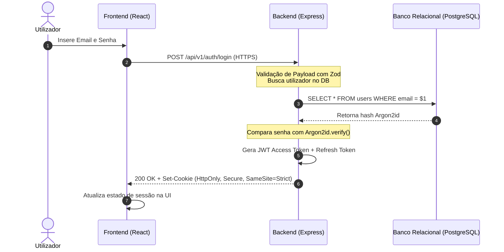

# Especificação de Autenticação & Segurança (Auth)

Este documento especifica o fluxo atual de autenticação e o plano de transição para arquitetura de produção segura.

---

### 1. Estado Atual (Client-Side Simulation)

- **Fluxo de Registro:**
  - O utilizador submete nome, email e senha em [`Register.tsx`](file:///c:/Users/victo/OneDrive/Documentos/Github/UniFinance/src/pages/Register.tsx).
  - A senha sofre codificação reversível com `btoa(password)` no cliente.
  - O perfil e as credenciais são gravados nas chaves `unifinance_profiles` e `unifinance_credentials` do `localStorage`.
- **Fluxo de Login:**
  - Validação de correspondência de email e `passwordHash` no array de credenciais locais.
  - Gravação do ID ativo em `unifinance_logged_user_id`.
- **Risco Catalogado:** Documentado formalmente na nota de dívida técnica `mega-brain/debt/debt-001-insecure-auth-storage.md`.

---

### 2. Arquitetura Alvo de Produção (Zero-Trust Backend)

---

### 3. Requisitos Obrigatórios de Segurança para o Backend
1. **Hashing de Senha:** Utilização mandatória de `argon2id` ou `bcrypt` com fator de custo calibrado.
2. **Tokens de Sessão:** Access token com curta duração (15 min) em memória e Refresh token rotativo em cookie `HttpOnly`.
3. **Controle de Acesso Baseado em Funções (RBAC):**
   - Papéis: `USER` e `ADMIN`.
   - Rotas administrativas protegidas por middleware `requireRole('ADMIN')`.
4. **Proteção contra Brute Force:** Rate limiting nas rotas `/api/v1/auth/*` (máximo 5 tentativas por IP/minuto).
